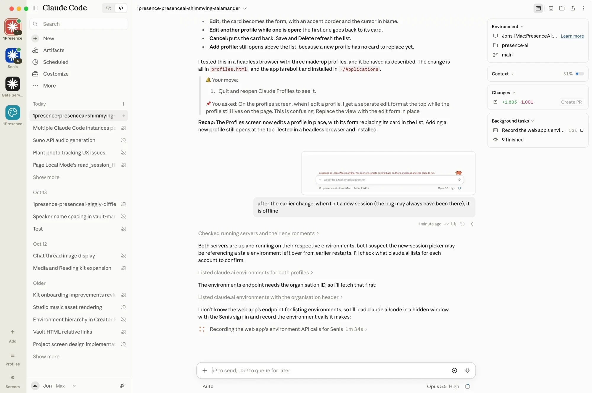

# Claude Profiles

An unofficial macOS app for running several Claude accounts side by side, each in its own isolated, signed-in workspace (Claude Code or Claude Design), with your Claude Code Remote Control servers managed from the same place.

> **Not affiliated with Anthropic.** Claude and Claude Code are trademarks of Anthropic. This is an independent tool that wraps claude.ai in a desktop shell and drives the official `claude` CLI.

> [!IMPORTANT]
> **Sign in by email, not Google or Apple.** Google and Apple block sign-in from inside apps like this one ("Couldn't sign you in. This browser or app may not be secure"). On the Claude sign-in page choose **Continue with email**, then **open the link in the email**: it opens in your normal browser and shows a **verification code**. Type that code into Claude Profiles. Details in [Signing in](#signing-in-by-email).



## Why this exists

Plenty of people have more than one Claude account on one Mac: a personal plan alongside a seat from their employer, a seat from each client they work for, or two subscriptions to cover their usage. Each needs its own sign-in, its own Claude Code login and MCP sign-ins, and its own folders kept apart. The existing options all break down somewhere:

- **The Claude desktop app is one account per Mac.** Only one copy runs at a time, and every Claude Code session it starts bills whichever account it is signed in to. Switching means signing out and back in.
- **Freeing a session on claude.ai hides it.** The only way claude.ai offers to free a server's place for a new session is to archive one. The conversation is kept, but the session drops out of your session list into the Archived filter, and you have to unarchive it before you can carry on.
- **Remote Control sessions never go away.** Each Remote Control session is a process on your Mac that stays alive after its last turn, holding 150 to 500 MB plus its MCP servers. They pile up: dozens of sessions holding over 10 GB is easy to reach. Nothing lists them, clears the idle ones, or brings one back when you want it again.
- **A restarted server strands its sessions.** Restart a Remote Control server too quickly and its open sessions show "can't reach this computer" for good. claude.ai offers no way to bring them back, and the CLI refuses to try while the folder has a server.
- **Every account looks the same.** Several Claude windows mean identical icons in the Dock and in ⌘Tab, so switching to the right account is guesswork.
- **Web apps don't fill the gap.** Safari web apps keep each login separate, but links from Claude either stay trapped inside the web app or are silently dropped instead of opening in your browser. Chrome merges every claude.ai install across all your Chrome profiles into one Dock app with a profile-switching menu, so you can't give each account its own app.
- **Folders and accounts get crossed.** Nothing stops a project's Claude Code sessions from running under the wrong account.
- **Claude Design is one more tab per account.** Designing for a client in their account and for yourself in yours means yet more browser windows with the same icon, each needing its own sign-in.
- **Remote Control sessions can't reach Claude Design.** Opening a design link or running `/design-sync` needs a Claude Design authorization that only `/design-login` sets up, and `/design-login` runs only in an interactive terminal, not in a session you drive from claude.ai or your phone.

Claude Profiles fixes all of these in one app.

## Features

- **Your session history is kept, and servers never fill up.** Nothing the app does deletes a session or its conversation. Ending a session, automatic cleanup and restarting a server stop processes on your Mac and free their memory; the session stays on claude.ai and you can open it and carry on. When a server nears its session limit, the app archives the sessions that have been quiet longest, so new sessions always have room, and opening one of those unarchives it for you. See [Ending sessions keeps your history](#ending-sessions-keeps-your-history).
- **Multiple windows, one per desktop.** Open as many windows as you like (⌘N), each showing its own profile, and put one on each macOS desktop so a three-finger swipe moves between accounts. Two windows on the same account share its sign-in.
- **The app icon becomes the active profile's icon.** In the Dock and the ⌘Tab switcher you see exactly which account you are switching to. Icons are fitted to the standard macOS icon grid, so they sit at the same size as your other apps.
- **Isolated sign-in per profile.** Each profile has its own cookies, storage and cache, so each stays signed in to its own account with no crossover.
- **A sidebar of your accounts**, with your own icons. Click one or press ⌘1 to ⌘9.
- **Create profiles in the app.** Give a profile a name, the email of its Claude subscription, an icon, and the working folders on your Mac its Claude Code sessions use. A setup checklist on each profile tells you what is done and what is left.
- **Claude Design profiles too.** Add profiles that open Claude Design (claude.ai/design) instead of Claude Code, with a palette icon in your colour, in the same sidebar and windows as everything else. A Design profile can share the sign-in of a Claude Code profile on the same account, so one sign-in covers both.
- **No icon design needed.** Pick a colour from a preset or the macOS colour wheel and the app makes an icon: a white spark (Code) or palette (Design) on that colour. Or use any image you like. The marks are original, not Anthropic's logos.
- **Remote Control servers, managed for you.** Each profile's folders get a `claude remote-control` server that runs as a launchd job, so it keeps running when the app is closed and comes back after a restart. Start, stop and restart from the **Servers** screen.
- **Restarts keep your sessions.** Restarting a server waits for the old one to exit, so its sessions reconnect. A server that dies is started again within a minute and keeps its sessions too.
- **Stranded sessions come back when you open them.** Open a session no server can reach any more and the app carries it on as a new session with the whole conversation, then switches the view to it.
- **See and clear sessions.** Every open session is listed by its title (the same one claude.ai's sidebar shows), with its last activity and memory, **End** to free its memory (in one click, and it stays in your history) and **Keep** to protect it.
- **Automatic cleanup (optional).** Once an hour, end sessions that have been idle for 3 hours or more.
- **Claude Design for Claude Code sessions.** Authorize a profile's Claude Code sessions to open and update Claude Design projects from its setup checklist, with no terminal. Approve with the profile's own account or any other signed-in profile's; the step shows which account approved it, and **Re-authorize** switches account.
- **MCP servers per account.** See each profile's MCP servers and claude.ai connectors, grouped by where they are configured. Sign in again to the ones that need it, under the right account, and add or remove servers, all from the Servers screen.
- **Links behave.** Links to anything outside Claude open in your default browser. Claude links stay in the profile. Right-click any link for **Open Link in Browser** or **Copy Link**.
- **Guard rails.** Warns when a profile's Claude Code login is a different account from the profile's, refuses to start a server in a folder Claude Code hasn't trusted, and can pin folders to accounts (for example, a client's folders may only run under that client's account).
- **Status at a glance.** A dot on each profile's icon shows whether its servers are running, and a badge shows how many sessions are open.
- **Pages that fail to load recover.** If a page can't load (the network dropped after sleep, say) or its page process stops, the profile shows why and keeps trying, instead of staying blank.

## Requirements

- macOS. Built and tested on macOS 15 on an Intel Mac. `npm run package` builds for the Mac it runs on, so Apple Silicon gets a native build from the same source.
- [Node.js](https://nodejs.org/) 20 or later, to build the app.
- [Claude Code](https://docs.anthropic.com/en/docs/claude-code) installed, with `claude` on your shell's `PATH`, and a version that supports `claude remote-control`.
- A Claude subscription for each account that includes Claude Code and Remote Control.
- For Claude Design access from Claude Code, a Claude Code version with `claude design-login` (tested with 2.1.305).

## Install

```bash
git clone https://github.com/jonkafton/claude-profiles.git
cd claude-profiles
npm install
npm run package
```

`npm run package` builds the app and installs it as `~/Applications/Claude Profiles.app`, signed ad hoc for your own Mac. Open it from there and pin it to the Dock. To update later, `git pull` and run `npm run package` again; your Dock pin keeps pointing at the new version, and the previous build is kept in `dist/` (delete it whenever you like).

## Setting up a profile

When the app opens for the first time it shows the **Profiles** screen with a new profile form. Later, use **Add** at the bottom of the sidebar or **Profiles → Add Profile…**.

1. **Fill in the profile.**
   - **Type**: **Claude Code** (this section) or **Claude Design** (see [Claude Design profiles](#claude-design-profiles); it skips the folder and Terminal steps).
   - **Name**: what the sidebar shows, for example "Work".
   - **Claude account email**: the email of the Claude subscription this profile uses, on the web and in Claude Code.
   - **Icon**: pick a colour (a preset swatch, or any colour from the colour wheel) to get a white spark on that colour, or choose any image. It is used in the sidebar and as the app icon while the profile is active. A new profile without one gets a coloured spark automatically.
   - **Working folders**: choose the project folders on your Mac that this account's Claude Code sessions work in. Each folder gets its own Remote Control server.
   - **Advanced**: the **Claude Code config folder** (`CLAUDE_CONFIG_DIR`) holds this account's Claude Code login and settings. Leave it empty to get a new, separate one at `~/.claude-<profile-id>`, or choose an existing folder, such as `~/.claude`, to reuse a login you already have. You can also change the start page (default `https://claude.ai/code`).
2. **Press Create profile.** The profile now shows a setup checklist. Each step ticks itself off when it is done.
3. **Sign in to Claude in the profile.** Press **Open profile** and sign in **by email** ([how](#signing-in-by-email)).
4. **Sign Claude Code in to the same account.** Press **Sign in in Terminal**. Terminal opens Claude Code with this profile's config folder. Choose the Claude account option. When Claude Code shows a sign-in link, copy it, switch to Claude Profiles with this profile selected and press **⇧⌘V**: the link opens inside the profile, so the right account approves it. Paste the code it gives you back into Terminal, then type `/exit`.
5. **Trust each folder and allow Remote Control.** Press **Set up in Terminal** next to each folder. Answer `y` to "Trust this folder?" and to "Enable Remote Control?", wait for **Ready**, then press Ctrl+C.
6. **Start the servers.** Press **Open Servers** and **Start** each folder's server.
7. **Optional: let Claude Code use Claude Design.** Sessions that open a design link or run `/design-sync` need a Claude Design authorization of their own, which `/design-login` sets up. A Remote Control session can't run `/design-login`, so press **Authorize** instead. Choose the account whose design projects the sessions should reach: this profile's own, or any other signed-in profile's. The authorization is separate from the profile's Claude Code login, so it can be another account. Claude's approval page opens in a window on that account's sign-in. Check that it shows the right account, then press **Authorize** there; the window closes by itself. The step then shows which account approved it. To switch account, choose another and press **Re-authorize**: the new approval replaces the old one. The step is hidden for accounts that Claude Design isn't offered to. Claude Code notes that standalone Claude Design (claude.ai/design) closes by 14 December 2026.

Now open the profile, start a new Claude Code session, and choose the environment named after your folder, shown as `<folder> · <your Mac's name>`. The same sessions are reachable from the Claude app on your phone or any browser signed in to that account.

## Claude Design profiles

A Design profile opens [Claude Design](https://claude.ai/design) in its own sidebar slot, with its own icon and sign-in, alongside your Claude Code profiles. It is web only: no working folders, servers or Claude Code setup, so its setup checklist has a single step, signing in.

### Adding one

1. On the Profiles screen press **Add Design profile**, or choose **Claude Design** as the **Type** in the new profile form.
2. Fill in:
   - **Name**: for example "Work Design".
   - **Claude account email**: the account this profile signs in with.
   - **Sign-in**: **Its own sign-in**, or **Share <profile>'s sign-in** to reuse a Claude Code profile on the same account (see below). Choosing a profile to share fills in its email.
   - **Icon**: a white palette on terracotta unless you pick another colour, from a swatch or the colour wheel. Or choose any image.
   - **Advanced → Start page**: `https://claude.ai/design` by default. Point it at a specific design if you always start in the same one.
3. Press **Create profile**, then **Open profile** and [sign in by email](#signing-in-by-email). With a shared sign-in there is nothing to do if the other profile is already signed in.

### Sharing a sign-in

Sharing lets two profiles use one browser sign-in, so a Code profile and a Design profile on the same account need only one email sign-in between them. They then always use the same account: signing out of one signs out the other. A profile that borrows a sign-in can't lend it on, and a profile whose sign-in is in use by others can't be deleted until those profiles are changed. To stop sharing, edit the profile and set **Sign-in** back to **Its own sign-in**; it then needs its own sign-in.

### Using it

- **Windows and desktops:** like any profile, open it in its own window (⇧⌘ plus its number, or ⌘N while it is active) and keep it on its own desktop.
- **App icon:** while a Design profile is active, the Dock and ⌘Tab show its palette.
- **Links and previews:** pages on `claude.ai`, `claude.site` and `claudeusercontent.com` (where artifacts and design previews live) stay inside the profile. Everything else opens in your default browser.
- **Changing type:** editing a profile can switch it between Claude Code and Claude Design. Switching to Design removes its folders from the profile and stops their servers; switching to Code asks for folders. (Removing a folder from a Code profile stops that folder's server the same way.)
- **Availability:** Design profiles depend on claude.ai/design being available to your account. If it moves, change the profile's start page.

### Custom marks

To draw your own shape in the colour icons, save it as `marks/design.svg` (or `marks/code.svg` for Claude Code profiles) in the data folder (**Profiles → Show Data Folder**). New colour icons of that type then use your shape in white, centred on the colour you pick. Use a single-colour SVG with a `viewBox`; `currentColor` fills become white. These files stay on your Mac and are never part of the app, so you can use artwork you may not redistribute.

## Signing in by email

Google and Apple refuse to sign anyone in from an app that embeds a browser, whatever it presents itself as. If you press **Continue with Google** by habit, Claude Profiles recognises the "Couldn't sign you in" page, takes you back to Claude's sign-in page, and explains this. Email sign-in works for every Claude account, including ones you created with Google.

1. In the profile, choose **Continue with email** and enter the account's address.
2. Claude emails you a sign-in link. **Open the link.** It opens in your normal browser, and because that is not the browser that asked for it, Claude shows a **verification code** there instead of signing you in.
3. Back in Claude Profiles, **type that code** into the box under "If the link shows a verification code instead of signing you in, enter it here" and press **Verify email address**.

Alternatively, right-click the link in your email, choose **Copy Link**, then press **⇧⌘V** in Claude Profiles with the profile selected (**View → Open Copied Link in This Profile**). The link opens inside the profile and signs it straight in.

Do not paste the link itself into the code box: it expects the short code, and rejects the link with "There was an error verifying your code".

## Everyday use

| Shortcut | Does |
|---|---|
| ⌘1 to ⌘9 | Switch to a profile |
| Ctrl+Tab / Ctrl+Shift+Tab | Next / previous profile |
| ⌘N | New window on the current profile |
| ⇧⌘1 to ⇧⌘9 | New window on that profile |
| ⌘, | Profiles screen |
| ⇧⌘S | Servers screen |
| ⌘R | Reload |
| ⌘[ / ⌘] | Back / forward |
| ⇧⌘H | Back to the profile's start page |
| ⇧⌘O | Open the current page in your browser |
| ⇧⌘C | Copy the current page's link |
| ⇧⌘V | Open a copied link in the current profile |

Windows and their active profiles are restored when you reopen the app.

## Servers and cleanup

The **Servers** screen lists every profile's folders and their Remote Control servers.

- **Start / Stop / Restart** a server. Servers are launchd jobs, so they keep running when Claude Profiles is closed and start again after you log in. Stopping takes that server's sessions offline. A server is stopped the way Ctrl+C stops it, and the next one only starts once it has exited, so after a restart its sessions reconnect on their own. A server that dies is started again within a minute, and its sessions reconnect too.
- **Sessions** are listed by title, with their last activity and how much memory they hold (including their MCP servers). Titles and last activity come from claude.ai using that profile's sign-in; this uses claude.ai's internal web API, so if it ever changes the screen falls back to session IDs. **End** stops a session's process at once, with no confirmation, and frees its memory; the session stays in your claude.ai history. **Keep** protects a session from automatic cleanup.
- **Also running from a Terminal window**: if you already run `claude remote-control` by hand in a profile's folder, it shows here. When its sessions are done, press **Stop it**, then **Start** to hand the folder over to the app.
- **Other servers** lists Remote Control servers that match no profile, so you can stop strays.
- **MCP connections** lists, under each folder, what that profile's sessions connect to there: its own MCP servers, the folder's `.mcp.json`, and the account's claude.ai connectors. They are grouped the way `/mcp` groups them (Project, Local, User, claude.ai, Plugins), each under the file it comes from. They are checked when the screen opens and when you press **Check**, not on every refresh, because checking starts each server. Only the ones that need attention are listed; **Show all** lists the rest. Each profile has its own Claude config, so it has its own servers and its own sign-ins: a server added or signed in to under one profile, or in plain `claude` with the default `~/.claude`, is not there for another.
  - **Sign in** fixes a server that needs signing in. A claude.ai connector opens in a window signed in to that profile, so it is connected to the right account. Any other server opens in your default browser, and the app picks up the sign-in when the browser hands it back. **Cancel** gives up waiting.
  - **Open sessions keep the connections they started with.** New sessions get a new sign-in or a new server straight away; open ones do not. When a check finds a server newly connected or added, whether you did it here or with Claude Code in Terminal, the app offers **Restart server**: the sessions reconnect, and each loads its connections afresh on its next message. A restart keeps the sessions. A continued session (see [Restarts and stranded sessions](#restarts-and-stranded-sessions)) is not under a server: **End** it and open it again in its profile.
  - **Add server** adds one with `claude mcp add-json`. Choose where it goes: **User** (this profile, every folder), **Local** (this profile, this folder only) or **Project** (the folder's `.mcp.json`, shared with everyone who uses the folder, including every profile that serves it). Then choose HTTP, SSE or a command (stdio), and add headers or environment variables if it needs them; they are saved as plain text in that file. A server that signs in with OAuth needs no headers: add it, then press **Sign in**.
  - **Remove** removes a Project, Local or User server with `claude mcp remove`. claude.ai connectors and plugins are managed on claude.ai and in Claude Code.
  - **Pending approval** means the server comes from the folder's `.mcp.json` and has not been approved yet. **Open in Terminal** opens Claude Code there; approve it with `/mcp`. The approval is saved in the folder (`.claude/settings.local.json`), so it applies to every profile that serves that folder.
- **Automatic cleanup** is off until you switch it on. Once an hour it ends sessions that have been idle for `idleHours` (default 3), where idle means the session and everything it started used less than `idleCpuPerHour` CPU seconds per hour (default 30; an idle session uses about 10 to 20). A tool that finished since the last check counts as activity. **Preview** shows what it would end; **Run now** ends them immediately. Claude desktop app sessions are left alone unless you set `includeDesktop`.

### Ending sessions keeps your history

Preserving your history is a core promise of the app. **End** and automatic cleanup stop a session's process on your Mac; they never end or archive the session on claude.ai. It stays in claude.ai's session list with its whole conversation. Open it and send a message: a crashed Remote Control session is served again on its next message, and if that doesn't happen, the app carries it on as a new session holding the whole conversation (see [Restarts and stranded sessions](#restarts-and-stranded-sessions)). You can also continue one from Terminal with `claude --resume` in the folder, using that profile's `CLAUDE_CONFIG_DIR`.

**Session limit.** A Remote Control server accepts a fixed number of sessions (`--capacity`, 32 unless set). claude.ai counts every session in the server's environment that is active or paused, including ones you ended here, and once the count reaches the limit the new-session screen reads, for example, "32 of 32 used" and won't let you send a prompt. Only archiving a session frees its place. The app handles this for you in two ways:

- **A higher limit.** Every server starts with `--capacity 100`. To choose your own, set `--capacity` in the server's `args` in `profiles.json`. A server picks up a new limit when it restarts: press **Restart** on the **Servers** screen (its sessions reconnect).
- **Making room before it fills.** When a server is within 5 places of its limit (95 of 100), the app archives the 5 sessions that have been quiet longest, or more if it is already past that point. It never archives a session that is running on your Mac, one marked **Keep**, or one that claude.ai shows as working or waiting for you. It checks when you open the new-session screen in a profile, when a new session starts on a server, a minute and a half after the app opens, and every 5 minutes while it is open, at most once a minute. If a new-session screen is open when room is made, it reloads so the count is current.

**Archived is not deleted.** An archived session keeps its whole conversation. claude.ai lists archived sessions on its [Sessions page](https://claude.ai/code/sessions) (or **Group and sort → View all** in the sidebar; some layouts have a **Status** filter there with **Archived** and **All**). Open one of the sessions the app archived in its profile and the app unarchives it straight away, so you can carry on as with any other. A session you archived yourself is left for you to unarchive.

## Restarts and stranded sessions

### The challenge

Every time `claude remote-control` starts, it registers an *environment* with claude.ai for its folder, and every session it opens belongs to that environment. Stopped cleanly, a server keeps its environment and writes it to `bridge-pointer.json` in the Claude config's project folder. The next server takes the same environment back over and the sessions reconnect.

That only works if the old server has fully exited first. A new server that starts while the previous one is still shutting down registers a fresh environment instead. Every session of the old environment then shows "can't reach this computer" on claude.ai, permanently:

- **The server won't take them back.** It only serves its own environment.
- **A second server for the folder is refused.** Reattaching a session with `claude remote-control --session-id <id>`, or reusing the old environment through the pointer, fails with a 409 ("This folder is already served by another Claude Code on this device") while the folder's newer environment exists, even with its server stopped.
- **The conversation isn't lost, just unreachable.** It is still on disk as a transcript, but getting at it meant opening Terminal, finding the right Claude config and running `claude --resume`.

A plain stop followed by a start, which is what a Restart button does, hits the race every time. The old server is still shutting down, giving its sessions up to 30 seconds to finish, when the new one starts.

### How the app solves it

**Stopping a server cleanly.** The helper that launchd runs signals only the `claude remote-control` process, the way Ctrl+C would, and waits for it to exit. The launchd job allows a minute for that (`ExitTimeOut`). Signalling the whole process group would end every session underneath at once.

**Restarting in order.** **Restart** returns from the stop only once the server process has gone and launchd has finished unloading the job, and only then starts the next one. The new server finds the old environment free, takes it back over, and the sessions reconnect. A restart takes a few seconds, or up to about a minute while sessions finish what they are doing.

**Restarting a server that died.** The helper exits as soon as `claude` does. Before, the shell kept the job looking alive, so launchd never restarted it. Now launchd starts it again within its 60-second throttle, on the same environment.

**Continuing a session that is already stranded.** The interactive CLI is not bound by the one-server-per-folder rule: `claude --resume <transcript> --remote-control "<title>"` resumes a transcript with Remote Control on, beside the folder's server, and claude.ai shows it as a new session holding the whole conversation. So when a profile view opens a Remote Control session that is disconnected and whose environment no running server holds, the app does this:

1. It reads the session's record from claude.ai with that profile's sign-in. Only Remote Control sessions are touched, and only ones this Mac can serve.
2. It finds the transcript on disk. The CLI names a Remote Control session's transcript with a version 5 UUID of its session URL (`https://api.anthropic.com/v1/code/sessions/<id>`), so the file is found by name, not by guesswork. If it sits under another Claude config on this Mac, it is copied into the profile's own.
3. It starts the resume as a detached process, so it outlives the app the way the servers do. It reads the new session's ID from the record the CLI keeps in `<config>/sessions/<pid>.json`.
4. It switches the view to the new session and remembers the pair in `state/continued.json`. Opening the stranded original again goes straight to the continuation, and a continuation that has stopped (after a reboot, say) is continued again from the same transcript.

**Retiring dead environments.** Every environment a server ever registered stays on claude.ai, all with the same name. The new-session picker shows one entry per folder and can pick a dead one, so the folder reads "offline" while its server is running. Once a folder's server is online, the app archives this Mac's other environments for that folder (a minute after the app opens, a minute after **Start** and **Restart**, and every half hour while the app is open; see [Privacy and security](#privacy-and-security)). Archiving removes only the environment from the picker: its sessions stay listed on claude.ai, and opening one continues it as above. New sessions open where the composer was last pointed, which claude.ai keeps in the browser's storage for that sign-in. Pointed at a dead environment, the folder reads "offline"; once that environment is archived, claude.ai falls back to the cloud and remembers that instead. So before archiving, the app points that saved choice at the folder's live environment and reloads an open new-session screen. It also moves stars and per-place defaults (model, effort) from the archived environment to the live one.

Older sessions need two more steps, which the app also takes. Claude Code versions before about 2.1.300 named transcripts at random, so the app looks for one by content: claude.ai's event log for the session carries each message's ID, and the transcript stores the same IDs. Only transcripts created around the session's start are searched, so a large history stays quick. Such sessions, which have no environment on claude.ai, usually reconnect under their original address. And the interactive CLI can open on first-run screens (theme, welcome, folder trust) in a Claude config that has only ever run Remote Control. The app presses Enter for the default on each, as clicking through would, until the session has registered with claude.ai.

A continued session is listed on the **Servers** screen with the profile's other sessions, and **End** and automatic cleanup treat it like any other. A stranded session whose transcript isn't on this Mac, for example one from another computer, is left alone.

## Configuration

Everything the Profiles screen does is saved to `profiles.json` in the app's data folder (**Profiles → Show Data Folder**). You can edit it by hand; restart the app afterwards. See [`profiles.example.json`](profiles.example.json).

| Key | Meaning |
|---|---|
| `profiles[].id` | Fixed when the profile is created. It names the profile's sign-in storage, so changing it signs that profile out. |
| `profiles[].kind` | `code` (default) or `design`. Design profiles have no `configDir` or `servers`. |
| `profiles[].name`, `account`, `icon`, `url` | Sidebar name, Claude account email, icon file (relative to the data folder), start page (default `https://claude.ai/code`, or `https://claude.ai/design` for Design). |
| `profiles[].shareSignIn` | Optional id of another profile whose sign-in this one reuses. |
| `profiles[].configDir` | The profile's Claude Code config folder (`CLAUDE_CONFIG_DIR`). Must be signed in to `account`. |
| `profiles[].servers[]` | One entry per working folder: `id`, `folder`, and optional extra `args` for `claude remote-control` (for example `["--capacity", "200"]`; the app passes `--capacity 100` when the args set none). |
| `dockIconFollowsProfile` | `false` keeps the app's own icon instead of the active profile's. |
| `cleanup` | `idleHours`, `idleCpuPerHour`, `includeDesktop`. Switching cleanup on or off is done on the Servers screen. |
| `pairings` | Optional guard rails: `[{ "folderContains": "client-x", "configDir": "~/.claude-client-x" }]` means any folder whose path contains `client-x` may only run under that Claude Code config. |
| `launchdLabelPrefix` | Optional prefix for the launchd job labels (default `io.github.jonkafton.claude-profiles`). |

## Files and locations

| What | Where |
|---|---|
| Profiles, icons, settings, logs | `~/Library/Application Support/Claude Profiles/` (`profiles.json`, `icons/`, `state/`, `logs/`). `state/design-approvals.json` records which account approved each profile's Claude Design access (an email address, never a token). `state/archived-sessions.json` lists the sessions the app archived to make room (ID, title, folder), so it knows which ones to unarchive when you open them. |
| Each profile's web sign-in | `~/Library/Application Support/Claude Profiles/Partitions/profile-<id>/` |
| Server and cleanup jobs | `~/Library/LaunchAgents/io.github.jonkafton.claude-profiles.*.plist` |
| Claude Code logins | each profile's `configDir`, for example `~/.claude-work` |
| Server logs | `~/Library/Application Support/Claude Profiles/logs/<profile>-<folder>.err` and `manager.log` |
| What the app changes in Claude Code config folders | see [Privacy and security](#privacy-and-security) |

## Troubleshooting

- **"Couldn't sign you in. This browser or app may not be secure."** That is Google's block on embedded browsers. Sign in [by email](#signing-in-by-email).
- **"There was an error verifying your code."** You pasted the sign-in link into the code box. Open the link to get the code, or copy the link and press ⇧⌘V.
- **Claude Design was authorized with the wrong account.** On the Profiles screen, choose the right account in that profile's "Let Claude Code use Claude Design" step and press **Re-authorize**. The new approval replaces the old one. Claude Code has no command that removes only this authorization (`/logout` would also sign the profile's Claude Code out), so the app offers Re-authorize rather than Sign out.
- **A session says Claude Design needs `/design-login`, or can't fetch a design file.** That profile's Claude Code hasn't authorized Claude Design. On the Profiles screen, press **Authorize** under "Let Claude Code use Claude Design" in that profile's setup, then ask the session to try again. If an authorized profile still gets "HTTP 403", the account itself may not have access to that design project.
- **A profile shows "This page didn't load".** The page could not be reached, usually because the network dropped (waking from sleep, or a Wi-Fi or VPN change), or the page stopped unexpectedly. It tries again on its own, waiting longer after each failure, and straight away when the Mac comes back online. Press **Try Again** or ⌘R to try now. Each failure and its reason are written to `logs/manager.log`. Version 1.0.1 and earlier left the profile blank instead, until it was reloaded by hand.
- **"<folder> · <your Mac> is offline" in a session.** The session is pointed at a folder whose server is stopped, or at an old environment. Start the server on the Servers screen, or pick another environment under the message box. Versions before 1.0.1 could start a restarted server before the old one had exited, which gave it a new environment and left the old sessions on one nothing serves. Open one in its profile and the app carries it on as a new session; see [Restarts and stranded sessions](#restarts-and-stranded-sessions).
- **A server shows "Problem: folder not trusted for this profile", or Start says "Remote Control has not been accepted".** The profile's Claude config has not yet answered Claude Code's one-time prompts. Run step 5 of [Setting up a profile](#setting-up-a-profile) for that folder: **Set up in Terminal**, answer `y` to "Trust this folder?" and to "Enable Remote Control?", wait for **Ready**, press Ctrl+C, then **Start** the server. The error itself lists these steps.
- **"This profile expects A, but its Claude config is signed in as B".** Sessions would land in the wrong account. Run `/logout` in Claude Code with that config, then sign in again (step 4).
- **A server stays on "Starting…".** Check its `.err` log. The usual cause is `claude` not being found: the app takes `PATH` from your login shell, so make sure `claude` works in a new Terminal window.
- **A claude.ai connector says Google does not allow it to be connected from inside the app.** Google blocks its sign-in in embedded browsers. Choose **Open in Browser**; your browser must be signed in to claude.ai with that profile's account, or the connector is added to whichever account it is signed in to.
- **Sign in finished, but the server still needs signing in.** Press **Check**. If it still does, open Terminal from the server's row and run `/mcp` there to see the error.
- **Nothing happens when a setup step opens Terminal.** The first time, macOS asks whether Claude Profiles may control Terminal. If you declined, the command is copied to your clipboard instead; paste it into Terminal. You can change this in **System Settings → Privacy & Security → Automation**.

## How it works

- **Electron** (`BaseWindow` with one `WebContentsView` for the sidebar and one per profile or screen). Each profile uses a persistent session partition, `persist:profile-<id>`, which keeps its cookies and storage apart from every other profile.
- **Profile pages run sandboxed** with no Node.js access and no preload script, so claude.ai cannot reach the app's internals. Only the app's own screens can call the main process.
- **Servers** are launchd agents that run the app's own binary in Node mode (`ELECTRON_RUN_AS_NODE`) with `helper.js serve <key>`. The helper starts `claude remote-control` in the folder under the profile's `CLAUDE_CONFIG_DIR`, inside `script(1)` because `remote-control` needs a terminal. Each server's sessions are titled with its key so the app can tell its servers from hand-started ones.
- **Status** comes from `ps` and `lsof`: servers are `claude remote-control` processes, sessions are their children.
- **Cleanup** compares each session's CPU time between hourly runs and ends idle ones with `SIGKILL`.
- **Claude Design access** runs `claude design-login --json`, the form of `/design-login` that Claude Code provides for the VS Code extension. It prints the approval link as JSON instead of opening a browser, so the app opens it in a window on the chosen profile's sign-in, then waits for the CLI to report the result. `--status` reports whether a profile is authorized. Claude Code saves the credential under the profile's `CLAUDE_CONFIG_DIR`.
- **Pages that fail to load:** Electron shows nothing when a page fails to load or its renderer stops. The app replaces it with a small local page that names the error and retries the same address after 2, 5, 15, 30 and 60 seconds, then every 5 minutes, and at once when the Mac comes back online.
- **MCP connections** come from `claude mcp list`, run in the folder under the profile's `CLAUDE_CONFIG_DIR`. **Sign in** runs `claude mcp login <name> --no-browser` the same way, inside `script(1)` because the CLI wants a terminal, reads the link it prints, and opens it.

## Privacy and security

No telemetry, and no servers of its own. The app talks to claude.ai with each profile's sign-in, loads the pages you open, and runs the `claude` CLI on your Mac. Everything it does beyond showing pages is listed here.

### Calls to claude.ai in the background

These use claude.ai's internal web endpoints, the ones its own pages call, with the profile's sign-in. They are not a documented API: they can change without notice, and if one does, the feature that uses it stops working while the rest of the app carries on. Anthropic's [Consumer Terms](https://www.anthropic.com/legal/consumer-terms) restrict automated access to its services; read them and decide whether these calls suit your accounts.

| When | What the app does | Changes your account? |
|---|---|---|
| While the Servers screen is open, at most once a minute per profile | Lists your open Claude Code sessions, to show their titles and last activity. | No. |
| When a profile shows a Claude Code session | Reads that session's record, and for an older session its latest message IDs, to tell whether it is [stranded](#restarts-and-stranded-sessions). | No. If it is stranded, the app starts a new session from its transcript on your Mac, as `claude --resume` would. |
| When a profile shows claude.ai's new-session screen, when a new session starts on a server, 90 seconds after the app opens, and every 5 minutes while it is open (at most once a minute), for each profile with a running server | Lists your organisations, this Mac's environments and your active and paused sessions. For each running server within 5 places of its session limit, archives the sessions that have been quiet longest (see [Ending sessions keeps your history](#ending-sessions-keeps-your-history)), and records them in `state/archived-sessions.json`. | Yes: archives sessions. Their conversations are kept. |
| When a profile shows a session the app archived to make room | Unarchives that session and reloads the page. | Yes: unarchives the session. |
| A minute after the app opens, every 30 minutes while it is open, and a minute after **Start** or **Restart**, for each profile with a running server | Lists your organisations and this Mac's environments, then for each folder whose server is online: archives this Mac's offline environments for that folder, moves your starred environments and per-place defaults (model, effort) to the live one in your Claude Code settings, and points the saved place for new sessions at it in claude.ai's browser storage for that sign-in. | Yes: archived environments, those settings, and the saved place. There is no setting to turn this off yet. |

The launchd jobs that keep servers and cleanup running while the app is closed only run `claude` and local process checks; they make none of these calls.

### Changes on your Mac outside the app's data folder

- **`~/Library/LaunchAgents`**: a plist for each running server, and one for cleanup when it is on. Stopping a server moves its plist into the data folder (`state/launchd/`).
- **Claude Code config folders** (each profile's `configDir`):
  - Continuing a stranded session copies its transcript into the profile's config folder when it sits under another one.
  - Before the first continuation in a config folder that has only ever run Remote Control, the app marks Claude Code's onboarding as done in `.claude.json` (`hasCompletedOnboarding`), after saving a copy as `.claude.json.before-onboarding-<time>`. While a continuation starts, it presses Enter on any first-run screen.
  - When you ask, through the CLI: **Add server** and **Remove** (`claude mcp add-json`, `claude mcp remove`) write `.claude.json` or the folder's `.mcp.json`, and **Sign in** (`claude mcp login`) saves the server's token wherever Claude Code keeps it.
  - When you press **Authorize** for Claude Design, the app runs `claude design-login --json`, the form of `/design-login` that Claude Code provides for the VS Code extension. Claude Code saves the Claude Design authorization in its secure storage for that config folder.
- **Terminal**: setup buttons and **Open in Terminal** open a Terminal window with the command, through AppleScript. If macOS does not allow that, the command is copied to your clipboard instead.

### What it reads

- Each config's `.claude.json`: the signed-in email, folder trust, whether Remote Control was accepted, onboarding state, and the names (not the settings) of MCP servers. The names in a folder's `.mcp.json` the same way.
- Files Claude Code keeps in each config folder: `bridge-pointer.json` (a folder's environment), `sessions/<pid>.json` (which claude.ai session a process opened), and transcripts, which it searches for message IDs only to find an older stranded session's transcript.
- Processes: `ps` and `lsof` list `claude` processes, their working folders, and the `CLAUDE_CONFIG_DIR` in their environment.
- Whether a profile's storage holds claude.ai's sign-in cookie, to show setup progress. It never reads the cookie's value.
- Whether each Claude Code profile has authorized Claude Design, by running `claude design-login --json --status` with its config folder while the Profiles screen is open, at most every five minutes. The CLI reports yes or no; the app never reads the credential.

### The embedded browser

- Profile pages run sandboxed, with no access to the app or your files.
- They identify as the Chrome version the app embeds, because some sign-in pages refuse a browser that names Electron. Google and Apple refuse it anyway.
- Web permissions are limited to notifications, clipboard, fullscreen, and camera and microphone, which are granted together (claude.ai uses the microphone for voice input).
- A page that fails to load, or whose page process stops, is replaced by a short local error page that retries the same address. Electron, unlike Chrome, would otherwise show nothing at all.

## Uninstall

1. On the Servers screen, stop every server, and switch cleanup off.
2. Quit the app and delete `~/Applications/Claude Profiles.app`.
3. Delete any remaining `~/Library/LaunchAgents/io.github.jonkafton.claude-profiles.*.plist` files (stopped servers are parked in `state/launchd/` and are not loaded).
4. Delete `~/Library/Application Support/Claude Profiles/` to remove profiles and sign-ins, and any `~/.claude-<profile>` folders you no longer need. In config folders you keep, you can delete the `.claude.json.before-onboarding-*` backups the app made.

## Development

```bash
npm install
npm start           # run from source
npm run package     # build and install ~/Applications/Claude Profiles.app
npm test            # run the unit tests
```

The tests use Node's built-in test runner (Node 22 or later) and need no other dependencies. They run against fakes of Electron, `child_process` and launchd, with `HOME` pointed at a temporary folder, so they never start a server, load a launch agent or touch your profiles, sign-ins or real processes. `test/helpers/` holds the fakes. A test marked `todo` records a known defect: it is reported, but does not fail the run.

Servers started from a source run point at the development copy of Electron, so start your real servers from the installed app. Environment variables for testing:

| Variable | Effect |
|---|---|
| `CLAUDE_PROFILES_DIR` | Use another data folder for `profiles.json`, icons, state and logs. |
| `CLAUDE_PROFILES_USER_DATA` | Use another folder for sign-ins and window state. |
| `CLAUDE_PROFILES_LABEL_PREFIX` | Use another launchd label prefix, so test servers never touch real ones. |
| `CLAUDE_PROFILES_DEBUG=1` | Log the sidebar's console. With `CLAUDE_PROFILES_DEBUG_CLICK=<id>`, `CLAUDE_PROFILES_DEBUG_EVAL=<js>`, `CLAUDE_PROFILES_DEBUG_SHOT=<path>` and `CLAUDE_PROFILES_DEBUG_CLOSE_FIRST=1` / `CLAUDE_PROFILES_DEBUG_QUIT=1`, click a sidebar item, run a script in the active view, save screenshots, close the first window, or quit. |
| `CLAUDE_PROFILES_DEBUG_NET=1` | Log claude.ai API requests made by profile pages. |

## License

[MIT](LICENSE)

---

Made by [1Presence](https://1presence.com/?utm_source=github&utm_medium=readme&utm_campaign=claude-profiles).
